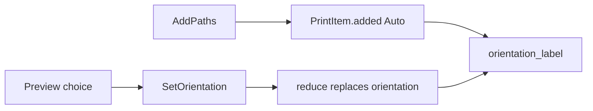

# Grounding: issue #5 preview Orientation

Source: direct read of `feat/issue-5-preview-orientation` at `fe16776` (same tip as `origin/main`). Nested how-explorers were not used. The previous owner stopped after spawning them and left no notes.

## Overview

Issue #5 lets a person open a preview for one Print Item, choose Landscape, Portrait, or PrinterDefault, and write that Orientation onto this item, every item of the same DocKind, or the whole list. Applying to all asks for confirmation. The list mark refreshes from the existing `orientation_label`. The work must succeed on a Dry Run list with no printer.

Facing and PageShape stay the add-time fact from issue #3. Orientation stays the policy the user sets. New rows still enter through `PrintItem.added`, which hard-codes Auto and has no orientation argument.

## Key Concepts

- **Orientation** (`types.Orientation`): Auto, Landscape, Portrait, PrinterDefault. Stored on `PrintItem.orientation`.
- **Facing** (`types.Facing`): Landscape or Portrait after `resolve_facing`. Not stored. PrinterDefault resolves to `None`.
- **PageShape**: `Measured` or `Unread`, probed once at add. Overrides do not rewrite it.
- **DocKind**: `pdf`, `docx`, `image`, `unknown`. "同类型" is equality on this field.
- **List mark**: `orientation_label` shows `横向` / `纵向` for a resolved facing and `打印机` when facing is `None`. Auto and a forced policy that resolves to the same facing share one word. Issue #3 tests lock that.
- **Batch command**: `BatchSession.apply` is the only writer path. `reduce` mutates `BatchState.items`. There is no preview module yet.

## How It Works

1. Add files. `AddPaths` → `expand_paths` → `PrintItem.added` stamps `Orientation.AUTO` and a probed shape.
2. The list binds `BatchSnapshot.items`. `orientation_label` calls `resolve_facing(item.orientation, item.shape)`.
3. Nothing in the main window opens a preview. The toolbar is add, add folder, and remove.
4. Dry Run start walks rows and ignores Orientation. A later print engine can read the policy. This issue only changes the policy and the mark.
5. There is no session-level last override and no settings field for one. A second add after a manual replace still births Auto (`test_added_row_stays_auto_after_an_earlier_override`).

## Where Things Live

| Concern | Path |
| --- | --- |
| Policy, fact, `resolve_facing`, `PrintItem.added` | `src/paperflick/core/batch/types.py` |
| Commands and `BatchCommand` | `src/paperflick/core/batch/commands.py` |
| Pure transition | `src/paperflick/core/batch/reduce.py` |
| Single writer | `src/paperflick/core/batch/session.py` |
| Row text | `src/paperflick/ui/item_list.py` |
| Shell | `src/paperflick/ui/main_window.py` |
| Planned preview module, absent | `src/paperflick/ui/preview_window.py` |
| List-mark tests | `tests/test_orientation_label.py` |

## Gotchas

- Do not write the inferred facing back into `orientation`. That collapses Auto and breaks the add-time default.
- Do not persist a last bulk choice in `Settings`. Product plan and issue #3 both forbid sticky inherit.
- `ItemsChanged` is the rebind signal. Counts do not change when only orientation changes, so a counts-only listener would miss the update. The main window rebinds on every event.
- A wide Auto row and a Landscape override of a wide row both read `横向`. Prove a mark change with a file whose inferred facing differs from the override, or with PrinterDefault (`打印机`).
- `reduce` ends in `return state, []`. A new command that is left off the `isinstance` chain is a silent no-op.
- Checkbox selection is multi-select for Remove. Preview needs exactly one checked row. There is no separate current-row pointer.
- Page raster for PDF and DOCX is not in the dependency set (`pypdf`, `Pillow`, `python-docx`). Pillow can show an image. Other kinds can still accept a direction when the page cannot be drawn. The product plan allows that failure.
- Real spooler submit does not exist. `choose_submit_port` raises `StartNeedsDryRunError` unless Dry Run is on. Orientation apply must not call that path.
