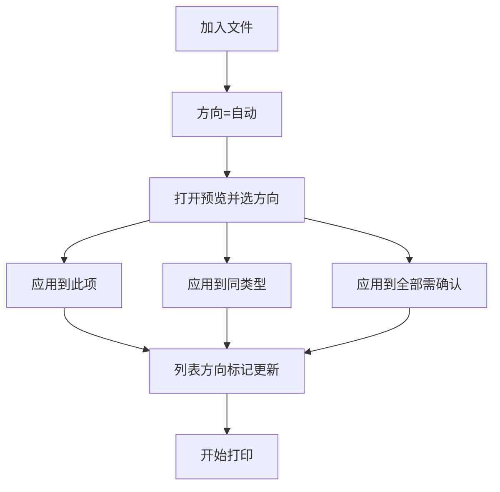
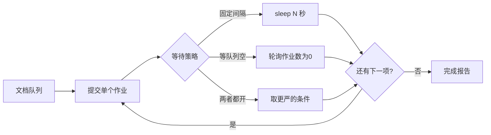

# PaperFlick（纸闪）产品规划

个人向、易用优先的 Windows 批量打印工具。

## 0. 命名

| | 名称 | 说明 |
|---|---|---|
| 英文 / GitHub | **PaperFlick** | Paper（文件/纸张）+ Flick（轻轻一甩/一点就打） |
| 中文 | **纸闪** | 短、好记，对应「快捷打印」 |
| 仓库名建议 | `PaperFlick` 或 `paperflick` | |

命名排查摘要：

- **PaperFlick**：未发现同名热门开源批量打印软件或大型应用商店独占产品；相近名 PaperCut（打印计费）拼写不同，可区分
- **PrintFlick**（未采用）：菲律宾有实体贴纸/标签印刷店品牌「PrintFlick PH」（Facebook / Instagram / 营业登记），同属印刷赛道，不宜占用
- 其它已排除：QuickPress（WordPress 生态重名多）、SnapPrint / 闪印（打印 App、开源 3D 工具等重名多）

## 1. 背景与目标

个人使用的 Windows 批量打印工具，强调快捷、好上手，不做企业级复杂能力。

核心目标：

- 方便添加多选文件或文件夹中的 **PDF / DOCX / 图片**
- 三点式操作：加文件 → 选打印机 → 开始打印
- **间隔串行**提交打印作业，避免 Windows Print Spooler 卡死
- 方向默认自动；可预览后手动调整，并支持批量应用
- 部分失败不中断整批，失败项可一键重打

## 2. 产品定位

| 要做 | 不做 |
|---|---|
| 个人日常批量打印 | 多打印机负载均衡 |
| PDF / DOCX / 图片 | 90+ 格式、CAD、邮件、压缩包、URL |
| 间隔 + 等队列防卡死 | 水印、封面、合并单一作业 |
| 预览改方向、失败重打 | 复杂逐文件纸盒/双面（跟打印机默认） |

易用主路径：拖拽列表 → 选打印机 → 开始打印 → 看进度与报告。  
差异化：可调发送间隔 / 等队列消化，专门缓解 Spooler 卡死。
## 3. 运行环境（已确认）

- **Microsoft Word**：已安装，许可证过期，仍可打印 → DOCX **优先 Word COM**
- **OnlyOffice**：本机有 → Word 失败时的 **备选**引擎
- 目标系统：Windows

## 4. 页面方向（横版 / 竖版）

**默认自动；可手动；手动须先预览；支持应用到此项 / 同类型 / 全部。**

| 模式 | 行为 |
|---|---|
| 自动（默认） | 宽 > 高 → 横向，否则纵向。PDF 看首页；DOCX 读页面设置；图片看像素比 |
| 手动横向 / 纵向 | 在预览窗修改后写入该项覆盖 |
| 跟随打印机 | 不改方向，交给打印机当前默认 |

预览窗按钮：

- **应用到此项** — 只改当前预览项
- **应用到同类型** — 只改同类（PDF / DOCX / 图片）；同类一批最常用
- **应用到全部** — 改列表全部文件（需二次确认）

约束：

- 新加入文件方向始终为 **自动**，不继承上次批量设置
- 列表每行显示：`自动` / `横向` / `纵向` / `打印机`
- 预览首版：PDF 首页、图片本体、DOCX 尽量首页（失败仍可选方向并应用）



## 5. 失败处理与重打

**原则：失败不丢、整批不中断、重打一键完成。**

打印过程中：

- 失败项标记为 `失败`，记录简短原因
- 不停止整批，继续后续文件
- 底部实时更新成功数 / 失败数

一批结束后：

- 简易报告：成功 N、失败 M
- 成功与失败行都保留在列表中

重打入口：

- **只勾选失败项**
- **重新打印失败项**（只勾失败 + 重置为等待 + 开始打印）
- **清除已成功**（列表只留失败项）

暂停 / 停止：

- **暂停**：当前文件打完后停，状态保留
- **停止**：中止后续；未处理仍为「等待」，可再开始或配合失败重打


## 6. 防 Spooler 卡死

- 并发恒为 **1**：一次只提交一个作业
- 等待策略：固定间隔 与/或 等 spooler 队列为空
- 单文件失败不中断；可配置超时（默认不重试）



## 7. 技术选型

| 项 | 选择 |
|---|---|
| 形态 | Windows 桌面 GUI（CustomTkinter） |
| 语言 | Python 3 + mamba 独立环境（不进 base） |
| 打印机 / 队列 | pywin32 |
| PDF | SumatraPDF 静默打印（检测本机路径） |
| DOCX | Word COM 优先 → OnlyOffice 备选 |
| 图片 | Pillow + Windows 打印 |
| 方向检测 | PDF mediabox / 图片 size / DOCX section 尺寸 |

## 8. 主界面（一屏完成）

- 工具栏：添加文件 / 添加文件夹 / 移除 / 清空 / 预览
- 失败相关：只勾选失败项 / 重新打印失败项 / 清除已成功
- 列表：勾选、路径、类型、方向、状态、失败原因；可拖拽排序
- 侧栏：打印机、间隔秒数、「等队列清空」、份数
- 操作：开始 / 暂停 / 停止
- 底部：进度 + 成功/失败计数 + 简短日志

## 9. 目标目录结构

```
PaperFlick/   # 或本地目录 printer-advance，GitHub 仓库名用 PaperFlick
  README.md
  docs/
    产品规划.md          # 本文档
  environment.yml
  requirements.txt
  src/
    main.py
    ui/
      main_window.py
      preview_window.py    # 预览 + 手动方向
      widgets.py
    core/
      models.py            # PrintItem 含 orientation
      queue_runner.py
      printers.py
      orientation.py
      settings.py
    handlers/
      base.py
      pdf_handler.py
      docx_handler.py      # Word → OnlyOffice
      image_handler.py
      registry.py
```

## 10. 首版实现任务

1. mamba 独立环境 + 项目骨架
2. 单作业串行调度（间隔 + 可选等队列清空）
3. PDF / DOCX / 图片打印分流与方向处理
4. 预览窗：应用到此项 / 同类型 / 全部
5. 失败保留 + 重新打印失败项 + 清除已成功
6. 主窗口列表与进度控制
7. 记住上次打印机与间隔、结束报告

## 11. 验收标准

1. 混合 PDF/DOCX/JPG 拖入后，默认方向自动，可按间隔出纸
2. 预览改方向后，「应用到同类型/全部」正确更新列表（全部需确认）
3. 人为放入 1 个坏文件：整批不中断；「重新打印失败项」只再打失败的那些
4. Spooler 不会被瞬间灌满
5. Word 过期仍能打 DOCX；Word 异常时尝试 OnlyOffice，日志标明引擎
