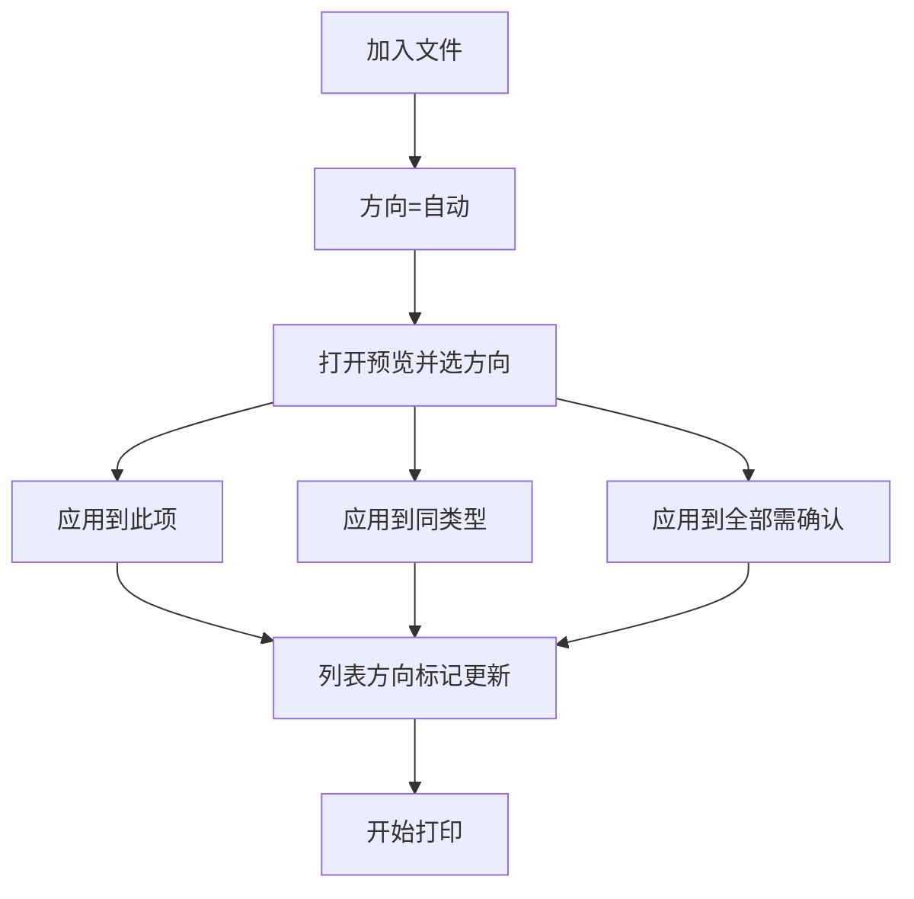
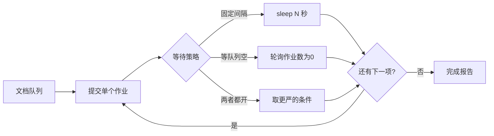

# PaperFlick（纸闪）产品规划

个人向、易用优先的 Windows 批量打印工具。

## 0. 命名

| | 名称 | 说明 |
|---|---|---|
| 英文 / GitHub | **PaperFlick** | Paper（文件/纸张）+ Flick（轻轻一甩/一点就打） |
| 中文 | **纸闪** | 短、好记，对应「快捷打印」 |
| 仓库名建议 | `PaperFlick` 或 `paperflick` | |

命名排查摘要：

- **PaperFlick**：未发现同名热门开源批量打印软件或大型应用商店独占产品；相近名 PaperCut（打印计费）拼写不同，可区分
- **PrintFlick**（未采用）：菲律宾有实体贴纸/标签印刷店品牌「PrintFlick PH」（Facebook / Instagram / 营业登记），同属印刷赛道，不宜占用
- 其它已排除：QuickPress（WordPress 生态重名多）、SnapPrint / 闪印（打印 App、开源 3D 工具等重名多）

## 1. 背景与目标

个人使用的 Windows 批量打印工具，强调快捷、好上手，不做企业级复杂能力。

核心目标：

- 方便添加多选文件或文件夹中的 **PDF / DOCX / 图片**
- 三点式操作：加文件 → 选打印机 → 开始打印
- **间隔串行**提交打印作业，避免 Windows Print Spooler 卡死
- 方向默认自动；可预览后手动调整，并支持批量应用
- 部分失败不中断整批，失败项可一键重打

## 2. 产品定位

| 要做 | 不做 |
|---|---|
| 个人日常批量打印 | 多打印机负载均衡 |
| PDF / DOCX / 图片 | 90+ 格式、CAD、邮件、压缩包、URL |
| 间隔 + 等队列防卡死 | 水印、封面、合并单一作业 |
| 预览改方向、失败重打 | 复杂逐文件纸盒/双面（跟打印机默认） |

易用主路径：拖拽列表 → 选打印机 → 开始打印 → 看进度与报告。  
差异化：可调发送间隔 / 等队列消化，专门缓解 Spooler 卡死。
## 3. 运行环境（已确认）

- **Microsoft Word**：已安装，许可证过期，仍可打印 → DOCX **优先 Word COM**
- **OnlyOffice**：本机有 → Word 失败时的 **备选**引擎
- 目标系统：Windows

## 4. 页面方向（横版 / 竖版）

**默认自动；可手动；手动须先预览；支持应用到此项 / 同类型 / 全部。**

规范名见根目录 `GLOSSARY.md`（**Auto / Landscape / Portrait / PrinterDefault**）。

| 模式 | 行为 |
|---|---|
| Auto（默认，UI：自动） | 宽 > 高 → Landscape，否则 Portrait。PDF：pypdf 首页 mediabox；DOCX：python-docx section；图片：Pillow size；读失败则按 Portrait 兜底并记日志 |
| Landscape / Portrait | 在预览窗修改后写入该打印项覆盖 |
| PrinterDefault（UI：打印机） | 不改方向，交给打印机当前默认 |

预览窗按钮：

- **应用到此项** — 只改当前预览项
- **应用到同类型** — 只改同类（PDF / DOCX / 图片）；同类一批最常用
- **应用到全部** — 改列表全部文件（需二次确认）

约束：

- 新加入文件方向始终为 **自动**，不继承上次批量设置
- 列表每行显示：`自动` / `横向` / `纵向` / `打印机`（对应 Auto / Landscape / Portrait / PrinterDefault）
- 预览首版：PDF 首页、图片本体、DOCX 尽量首页（失败仍可选方向并应用）



## 5. 失败处理与重打

**原则：失败不丢、整批不中断、重打一键完成。**

打印过程中：

- 失败项标记为 `失败`，记录简短原因
- 不停止整批，继续后续文件
- 底部实时更新成功数 / 失败数

一批结束后：

- 简易报告：成功 N、失败 M
- 成功与失败行都保留在列表中

重打入口：

- **只勾选失败项**
- **重新打印失败项**（只勾失败 + 重置为等待 + 开始打印）
- **清除已成功**（列表只留失败项）

暂停 / 停止：

- **暂停**：当前文件打完后停，状态保留
- **停止**：中止后续；未处理仍为「等待」，可再开始或配合失败重打


## 6. 防 Spooler 卡死

- 并发恒为 **1**：一次只提交一个 **Print Job**
- 等待策略：固定间隔 与/或 等 spooler 队列为空
- **默认**：间隔 **2 秒**；「等队列清空」**默认关闭**
- 单打印项失败不中断批次；可配置超时（默认不重试）



## 7. 技术选型

决策记录见 `docs/adr/`（0001–0004）与 `GLOSSARY.md`。

| 项 | 选择 |
|---|---|
| 形态 | Windows 桌面 GUI（**CustomTkinter**） |
| 语言 | **Python 3** + **mamba** 环境名 `paperflick`（不进 base）；已否决 Rust/Go 作首版 |
| 启动 | 开发：`python -m paperflick`；分发：Nuitka dist + Inno Setup（见 `docs/agents/release-checklist.md`） |
| 打印机 / 队列 | **pywin32** |
| PDF | **SumatraPDF** 静默打印（检测本机路径；缺失则该项失败） |
| DOCX | **Word COM** 优先 → **OnlyOffice** 备选（CLI/官方自动化为主，COM 次之）；日志标明引擎 |
| 图片 | Pillow + Windows 打印（pywin32） |
| 方向检测 | pypdf + Pillow + python-docx |
| 设置 | `%APPDATA%\PaperFlick\settings.json` |
| Dry Run | 与真打印共用 Batch 调度；仅在提交 Print Job 边界 no-op |

## 8. 主界面（一屏完成）

- 工具栏：添加文件 / 添加文件夹 / 移除 / 清空 / 预览
- 失败相关：只勾选失败项 / 重新打印失败项 / 清除已成功
- 列表：勾选、路径、类型、方向、状态、失败原因；可拖拽排序
- 侧栏：打印机、间隔秒数、「等队列清空」、份数、**Dry Run 开关**
- 操作：开始 / 暂停 / 停止
- 底部：进度 + 成功/失败计数 + 简短日志

## 9. 目标目录结构

```
PaperFlick/   # 本地目录可为 printer-advance；GitHub 仓库名 PaperFlick
  README.md
  GLOSSARY.md
  AGENTS.md
  docs/
    产品规划.md
    adr/
      0001-python-runtime.md
      0002-print-engine-stack.md
      0003-customtkinter-ui.md
      0004-settings-and-dev-launch.md
    agents/
  environment.yml
  requirements.txt
  src/
    paperflick/
      __init__.py
      __main__.py          # python -m paperflick
      ui/
        main_window.py
        preview_window.py
        widgets.py
      core/
        models.py          # Print Item + Orientation
        queue_runner.py    # Batch 调度；Dry Run 在提交边界分流
        printers.py
        orientation.py
        settings.py        # %APPDATA%\PaperFlick\settings.json
      handlers/
        base.py
        pdf_handler.py     # SumatraPDF
        docx_handler.py    # Word → OnlyOffice
        image_handler.py
        registry.py
```

## 10. 首版实现任务

1. mamba 环境 `paperflick` + `src/paperflick` 包骨架 + `python -m paperflick`
2. Batch 串行调度（默认间隔 2s；可选等队列清空）+ Dry Run 提交边界
3. PDF / DOCX / 图片打印分流与 Orientation 处理
4. 预览窗：应用到此项 / 同类型 / 全部
5. 失败保留 + 重新打印失败项 + 清除已成功
6. 主窗口列表与进度控制
7. AppData 记住上次打印机与间隔等；结束报告

## 11. 验收标准

1. 混合 PDF/DOCX/JPG 拖入后，默认 Orientation=Auto，可按间隔出纸
2. 预览改方向后，「应用到同类型/全部」正确更新列表（全部需确认）
3. 人为放入 1 个坏文件：整批不中断；「重新打印失败项」只再打失败的那些
4. Spooler 不会被瞬间灌满
5. Word 过期仍能打 DOCX；Word 异常时尝试 OnlyOffice，日志标明引擎
6. Dry Run 下走完加文件 → 开始 → 状态推进，且不向真实打印机送 Print Job
